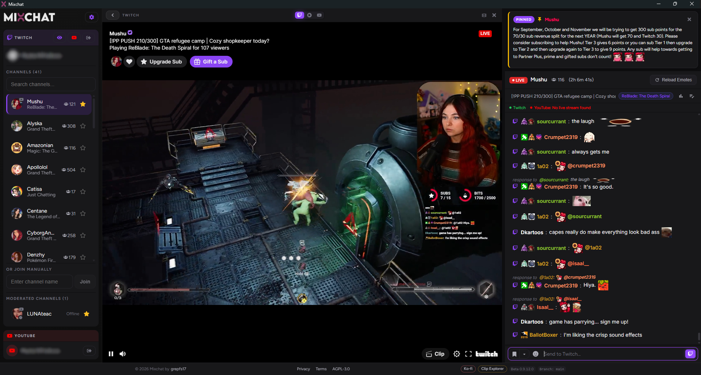
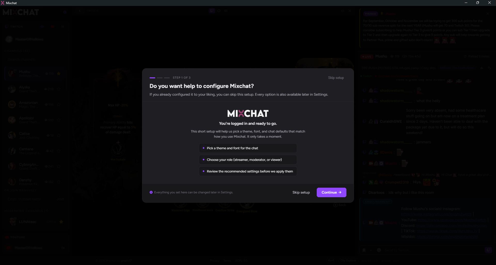

# MixchatDesktop

Tauri 2 desktop shell for Mixchat. It runs the Mixchat Astro Node server as a
bundled sidecar and opens the UI in the system webview: WebView2 on Windows,
WebKitGTK on Linux, WKWebView on macOS.

The [Mixchat](https://github.com/grepfs17/Mixchat) source comes from the sibling
checkout `../Mixchat` and is not forked here.

## Screenshots





## Download

Get the newest build from the
[latest release](https://github.com/grepfs17/MixchatDesktop/releases/latest).
Asset filenames include the release version. Each release also publishes
`SHA256SUMS.txt` and `.sig` files for the updater.

| Platform | Asset |
|----------|-------|
| [Windows 10/11 x64](https://github.com/grepfs17/MixchatDesktop/releases/latest) | `Mixchat_<version>_x64-setup.exe` |
| [Windows portable](https://github.com/grepfs17/MixchatDesktop/releases/latest) | `Mixchat-<version>-win-x64-portable.zip` |
| [Linux x64](https://github.com/grepfs17/MixchatDesktop/releases/latest) | `Mixchat_<version>_amd64.AppImage` |
| [macOS arm64](https://github.com/grepfs17/MixchatDesktop/releases/latest) | `Mixchat_<version>_aarch64.dmg` |

The NSIS installer bundles the WebView2 bootstrapper. The portable zip has no
installer: extract it and run `Mixchat.exe`. Settings, chat history, and logs
stay in `app-data` next to the executable. Login cookies live in
`%LOCALAPPDATA%\xyz.grepfs.mixchat` and are shared with the installed build. The
portable zip does not include WebView2, so install the Evergreen runtime first
if Windows reports it missing. Do not run the portable and installed builds at
the same time because both use `http://localhost:3000`.

The Linux AppImage is unsigned. Run it directly, after `chmod +x` if needed.
Data and logs live under `~/.local/share/xyz.grepfs.mixchat` and
`~/.local/state/xyz.grepfs.mixchat/logs`.

The macOS build is an unsigned arm64 DMG for macOS 13.5 or newer. Gatekeeper
blocks the first launch, so right-click the app, choose Open, then allow it in
System Settings, Privacy & Security.

## Using Mixchat

- Updates check on launch, about 10 seconds after the window opens, and from
  **Check for updates** in the right-click menu.
- Google sign-in opens in the system browser. Twitch sign-in opens the
  activation page in an in-app window and also signs the embedded player in.
- The right-click menu can restart the server, open the current log file, and
  open the Twitch login help.

### Windows and tabs

- `Ctrl/Cmd+N` opens a new window. Each window has its own tab strip and each
  window can show a different stream.
- `Ctrl/Cmd+T` adds a tab, `Ctrl/Cmd+W` closes it, and `Ctrl/Cmd+Shift+W`
  closes the whole window. Middle-click also closes a tab.
- `Ctrl/Cmd+Tab` or `Ctrl/Cmd+Shift+Tab` cycles tabs. `Ctrl/Cmd+1` through
  `Ctrl/Cmd+9` jumps to a tab, and `9` selects the last one. With the tab strip
  focused, the left and right arrow keys move between tabs.
- Every tab has a mute button. `Ctrl/Cmd+Shift+M` mutes or unmutes the active
  tab. Muting silences chat sounds and the stream together.
- Hidden tabs keep their page, chat connection, and stream alive. Mute the
  background streams you do not want to hear.
- **Open stream in new window** in the right-click menu duplicates the current
  stream into a separate window.
- On macOS, muting a tab suspends media playback instead of changing a gain;
  unmuting resumes it.

## Development

### Requirements

- Windows 10 or 11, macOS 13.5 or newer, or a recent Linux desktop with WebKitGTK
- Node.js LTS and pnpm
- Rust 1.90 or newer (`rustup`, `cargo`)
- The [Mixchat](https://github.com/grepfs17/Mixchat) checkout at `../Mixchat`
- A `.env.desktop` profile with OAuth client IDs

### Setup

Clone Mixchat next to this repo and install its dependencies once:

```bash
git clone https://github.com/grepfs17/Mixchat.git ../Mixchat
# inside ../Mixchat
pnpm install
```

Then prepare this shell:

```bash
# inside this repo
pnpm install
cp .env.desktop.example .env.desktop
```

Fill in `.env.desktop`:

- `PUBLIC_TWITCH_CLIENT_ID`: Twitch app with Client Type = Public.
- `PUBLIC_YOUTUBE_CLIENT_ID`: Google OAuth client of type Desktop app.
- `YOUTUBE_CLIENT_SECRET`: the Desktop-app client secret. Google requires it
  even for PKCE desktop clients and treats it as non-confidential.

Redirect URIs must stay on `http://localhost:3000/auth/...` unless you rebuild
Mixchat with matching values.

Build the local server bundle and fetch the Node sidecar:

```bash
pnpm tauri:prepare
```

### Run

Run Mixchat's dev server in one terminal:

```bash
# inside ../Mixchat
pnpm dev
```

Start the shell against it in another terminal:

```bash
# inside this repo
pnpm dev
```

`pnpm dev` waits for the external server at `http://localhost:3000`. To run
against the locally prepared bundle instead, use `pnpm start`. That spawns the
bundled sidecar.

### Build

Run `pnpm tauri:prepare` once before packaging. Then `pnpm tauri:build` builds
the installer for the host platform. Set `TAURI_SIGNING_PRIVATE_KEY` first if
the build must sign updater artifacts (see [Updates](#updates)).

`tauri:prepare` builds Mixchat with `PUBLIC_APP_PLATFORM=desktop`, patches and
copies the server bundle to `src-tauri/resources/mixchat`, installs `jsdom`
beside it, and downloads the Node sidecar for the target triple. The secret
guard runs before packaging and fails if confidential hosted-site values appear.
See [SECURITY.md](./SECURITY.md).

#### Windows installer

```bash
pnpm tauri:prepare
pnpm tauri:build
```

Output: `src-tauri/target/release/bundle/nsis/`.

#### Portable Windows

```bash
pnpm tauri:build:portable
```

This applies `src-tauri/tauri.portable.conf.json` and writes
`src-tauri/target/portable/Mixchat-<version>-win-x64-portable.zip`. When
`TAURI_SIGNING_PRIVATE_KEY` is set, the zip is signed for portable updates.
`pnpm tauri:portable` rebuilds the zip from an existing release build.

To cross-build the same zip from Linux, with Docker and network access:

```bash
pnpm tauri:build:portable:win
```

The Windows SDK, Rust toolchain, and cargo registry are cached in
`~/.cache/mixchat-tauri`. The GUI still needs WebView2, so run the extracted app
on Windows.

#### Linux AppImage

Install the WebKitGTK development packages first:

```bash
# Debian/Ubuntu
sudo apt-get install -y build-essential curl wget file librsvg2-dev libssl-dev \
  libgtk-3-dev libayatana-appindicator3-dev libxdo-dev pkg-config \
  libwebkit2gtk-4.1-dev

pnpm release:linux
```

Output: `src-tauri/target/release/bundle/appimage/Mixchat-<version>_amd64.AppImage`.
`release:linux` runs `pnpm tauri:prepare` once and fails if the artifact or its
updater signature is missing. `pnpm tauri:build` also produces the AppImage on
Linux. The artifact is large because it embeds the Node sidecar and server
bundle. There is no `.deb` or `.rpm` package yet.

#### macOS

```bash
pnpm release:macos
```

Output:

- `src-tauri/target/release/bundle/dmg/Mixchat-<version>_aarch64.dmg`
- `src-tauri/target/release/bundle/macos/Mixchat.app.tar.gz` and `.sig`

`release:macos` runs `pnpm tauri:prepare` once and fails if the DMG or updater
signature is missing. Builds use Apple Silicon because the bundled Node sidecar
requires macOS 13.5 or newer. There is no Developer ID signing or notarization.

### Updates

Installed Windows NSIS builds, Linux AppImages, macOS builds, and the portable
Windows zip check for updates on launch and from the right-click menu. The
updater runs in Rust, so the webview keeps no Tauri IPC permissions. NSIS
installs stop the `mixchat-node.exe` sidecar first, and
`src-tauri/windows/installer-hooks.nsh` kills leftovers so the executable is not
locked during install.

Portable updates download the signed zip, then a PowerShell helper waits for
Mixchat to exit, replaces the program files, preserves `app-data`, and restarts
Mixchat. The result is recorded in `app-data/logs/updater.log`.

Updates use minisign. The public key is in `src-tauri/tauri.conf.json` under
`plugins.updater.pubkey`. The private key must never be committed. Local builds
need it in the environment:

```bash
export TAURI_SIGNING_PRIVATE_KEY="$(cat "$HOME/.tauri/mixchat-updater.key")"
export TAURI_SIGNING_PRIVATE_KEY_PASSWORD=""
```

The release workflow reads the same values from the repository secrets
`TAURI_SIGNING_PRIVATE_KEY` and `TAURI_SIGNING_PRIVATE_KEY_PASSWORD`. The key
secret holds the file contents, not a path. The workflow uploads the `.sig`
files and writes `latest.json` at
`https://github.com/grepfs17/MixchatDesktop/releases/latest/download/latest.json`.
The newest published release must be the version clients should install and
must not be a prerelease.

To generate a replacement keypair:

```bash
pnpm tauri signer generate -w ~/.tauri/mixchat-updater.key
```

Put the new public key in `tauri.conf.json`, add the private key to CI, and keep
a backup. Replacing the public key strands existing installs until a release
signed with the old key migrates them.

### Architecture

- `src-tauri/src/server.rs` spawns the Node sidecar, waits for
  `/api/parent-domain`, logs output, restarts crashes with backoff, and kills the
  process on exit.
- The shell holds every loopback address the window hostname resolves to that
  the sidecar did not bind, and forwards those connections to the sidecar. This
  stops another local user from answering the window origin through the other
  address family.
- `tabs.rs` owns the workspace model. A workspace is a native window with one
  tab-strip webview and one content webview per tab, built on Tauri's
  `unstable` multi-webview API. Hidden tabs are kept alive, and native mute
  uses WebView2's `IsMuted`, WebKitGTK's `is-muted`, or macOS media suspension.
  The tab strip is served from the `mixchat-tabs` custom protocol.
- The window loads `MIXCHAT_URL` (default `http://localhost:3000`). Keep the
  host and port aligned with OAuth redirect URIs.
- Server data lives in the Tauri app data directory. Logs are available from
  **Open logs** in the right-click menu.
- The shell sets `window.__MIXCHAT_SHELL__ = 'tauri'` and loads
  `?mixchat-shell=tauri` so the shared Mixchat bundle selects the desktop auth
  flow.
- Google sign-in uses a system-browser handoff. The server stores the token
  exchange in a short-lived record and the app polls for it, then sets auth
  cookies in its own cookie jar.
- OAuth and Twitch activation URLs open with `POST /api/desktop/open` on the
  local server. The webview never navigates for those links, which avoids the
  WebView2 reload.
- Downloads from the local Mixchat server are taken over by the shell. The
  injected script cancels the anchor download, `downloads.rs` streams the file
  to the user's Downloads folder with the webview cookies, and an in-page panel
  shows byte progress, speed, cancel, and a show-in-folder action. The webview's
  own download UI is never shown, on every platform the same way.

### Tests

```bash
pnpm test          # Rust shell and build-script tests
pnpm test:rust     # cargo test inside src-tauri/
pnpm test:scripts  # node --test on scripts/*.test.mjs
```

The script tests use temporary directories and do not touch the real `../Mixchat`
checkout or `.env` files.

### Configuration

The shell reads these `MIXCHAT_*` keys.

| Key | Purpose |
|-----|---------|
| `MIXCHAT_PORT` | Local server port (default `3000`, must match OAuth redirects) |
| `MIXCHAT_HOST` | Server listen address (default `127.0.0.1`) |
| `MIXCHAT_URL` | Origin the window loads (default `http://localhost:<port>`) |
| `MIXCHAT_DIR` | Mixchat checkout if not `../Mixchat` |
| `MIXCHAT_CONFIG` | Explicit desktop `.env` file |
| `MIXCHAT_MODE` | `dev`, `local`, or `packaged` (normally inferred) |

A `.env` file can live in the app data directory, the app config directory, or
next to the executable. Development builds also read the repository root and
current directory. Process environment variables win over file values. Only
known-safe keys are forwarded to the spawned server.

### OAuth

| Provider | Flow | Secret in binary |
|---|---|---|
| Twitch | Device Code Grant, public client | None |
| Google/YouTube | PKCE Desktop-app client, system-browser handoff | Desktop-app client secret (non-confidential) |

The hosted website's Twitch and Google web client secrets are never embedded.
The build guard fails if they appear.

## License

Licensed under AGPL-3.0, same as [Mixchat](https://github.com/grepfs17/Mixchat).
See [LICENSE](./LICENSE).
